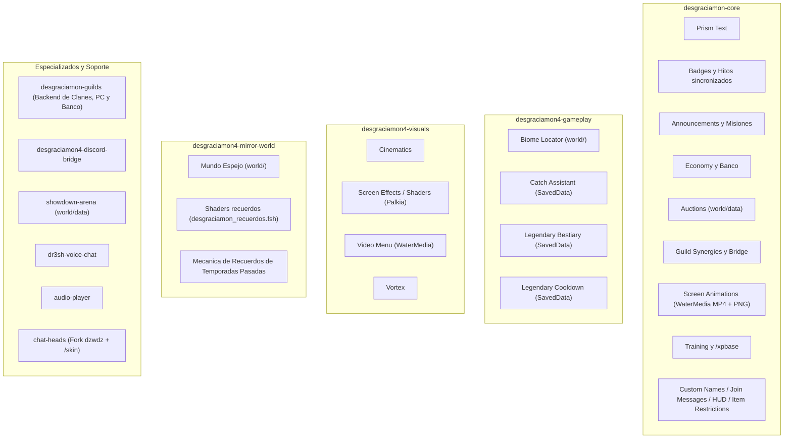

# ESTADO ACTUAL DEL PROYECTO - DESGRACIAMON MODS 4

> [!IMPORTANT]
> **LECTURA OBLIGATORIA PARA CUALQUIER ASISTENTE / AGENTE:**
> Antes de realizar cualquier modificacion, consulta o build en este workspace, es mandatorio leer este documento en su totalidad para mantener la coherencia del estado del proyecto, entender la arquitectura unificada y evitar reintroducir componentes obsoletos.

---

## 1. Ficha Tecnica del Entorno
* **Juego base:** Minecraft Java Edition `1.21.1`
* **Modloader:** Fabric Loader `>=0.16.0` (Fabric API, Fabric Language Kotlin `>=1.13.6`)
* **Version de Java requerida:** Java 21 (`C:/Program Files/Eclipse Adoptium/jdk-21.0.12.101-hotspot`)
* **Mod Nucleo de Criaturas:** Cobblemon `1.7.3`
* **Ultima Actualizacion del Estado:** 20 de Noviembre de 2026 (Cinemáticas v2 con `/cinematicas`, Toolbox Director y visibilidad del jugador; Precalentamiento real conectado a GitHub/Cinemáticas; Insignias 100% pixel art con aviso personal + insignia `Constructor`; Luces de Arena con 49 efectos y GUI Editor; Controles e invariantes anti-dupeo en Gremios; `/zonaprotegida spawn`)

---

## 2. Arquitectura de Modulos (Suite Unificada)

El proyecto paso por una unificacion arquitectonica mayor (los respaldos pre-unificacion residen en `backup_pre_unificacion/`). Se redujeron mas de 20 mods independientes a **4 suites modulares + 3 mods especializados + 2 utilidades de audio**:

---

## 3. Detalle y Estado por Modulo

### 1. `desgraciamon-core`
* **Estado:** Actualizado (`desgraciamon-core-1.0.0.jar` - 18/11/2026).
* **Sub-modulos integrados:**
  * `com.desgraciamon.prismtext`: Parser de colores, gradientes y formato de texto.
  * `com.desgraciamon.badges`: Medallas de gimnasio, Liga Pokemon e Hitos sincronizados con progreso (guardado en `world/data/desgraciamon4_badges/players.json` y `config/desgraciamon4_badges/hitos.json`).
  * `com.desgraciamon.announcements`: Tablon de anuncios y sistema integral de misiones diarias rotativas, manuales/permanentes y de gremio (guardado en `world/data/desgraciamon4-announcements-progress.json`, `world/data/desgraciamon4-announcements-daily.json` y `config/desgraciamon4-announcements/daily-missions.json`).
  * `com.desgraciamon.customnames` y `joinmessages`: Nombres con color y mensajes de bienvenida (guardado en `world/customnames.json`).
  * `com.desgraciamon.screenanimations`: Reproductor de animaciones MP4 por WaterMedia (compatible con GitHub `manifest.json` / ZIP / archivos locales `.mp4`) y respaldo por frames PNG.
  * `com.desgraciamon.hud`: Personalizacion del HUD del cliente.
  * `com.desgraciamon.itemrestrictions`: Restricciones de items por progresion.
  * `com.desgraciamon.economy`: Economia y banco (guardado en `world/data/desgraciamon4_economy/market_state.json`).
  * `com.desgraciamon.auctions`: Sistema de subastas in-world (guardado en `world/data/desgraciamon4_auctions/auction.json`).
  * `com.desgraciamon.training`: Sistema de entrenamiento y multiplicador global `/xpbase` (guardado en `world/data/desgraciamon_xp_base.json`).
  * `com.desgraciamon.guilds`: Comandos de sinergias y puente reflectivo hacia `desgraciamon_guilds`.
* **Cambios recientes (17/11/2026):**
  * **Multiplicador XP base configurable (`XpMultiplierManager.kt`, `TrainingMod.kt`):** Comando `/xpbase [porcentaje]` que ajusta la experiencia base recibida en `CobblemonEvents.EXPERIENCE_GAINED_EVENT_PRE` con `Priority.HIGHEST`, de modo que los multiplicadores de gremio y catch-up (`Priority.NORMAL`) toman este nuevo valor base al multiplicar.
  * **Motor WaterMedia `.mp4` y sincronizacion GitHub en vivo en `screenanimations` (`RemoteAnimationsDownloader.kt`, `ScreenAnimationsMod.kt`, `ScreenAnimationsClient.kt`):** Soporte directo de archivos `.mp4` y descarga desde GitHub (`Dr3sh/desgraciamon-assets/animations/manifest.json` o `.zip`), cache-buster `?cb=` con `Cache-Control: no-cache` para evitar respuestas cacheadas de Fastly/GitHub CDN, sincronizacion segura en servidor (`syncRemoteOnServer`), autocompletado de animaciones locales y remotas en `reproducir`/`precalentar`/`precargar`, comandos `/animacion recargar [jugadores]`, `/animacion sync_github [jugadores]`, `/animacion sync_remoto [jugadores]` y `/animacion actualizar [jugadores]`, cierre automatico de videos WaterMedia al finalizar (`ended()`/`stopped()` y verificacion de duracion antes de consultar la textura residual), y hook `renderTopLayerFromVisuals` para garantizar Capa 1 siempre encima de los efectos de Capa 0.
  * **Sistema de Hitos sincronizado e interfaz renovada (`HitosData.kt`, `BadgeData.kt`, `BadgeNetwork.kt`, `GymDefeatListener.kt`, `BadgesClient.kt`, `BadgesMod.kt`, `HitosTimelineScreen.kt`):** Eventos de relleno visibles (`progression = false`) pero excluidos del calculo de progreso; barra central de dia del servidor (`HOY: Dia X` y `/hitos admin setdiaactual <dia>`); pantalla `HitosTimelineScreen` rediseñada con navegacion rapida (`<`, `Hoy`, `>`), barra personal `X/Y (Z%)`, indicador de siguiente hito, tarjetas estructuradas con barra de estado, insignia de orden/`EVENTO`, filas `Lider:` y `Rec:`, botones de reclamo/catch-up `x1.5 XP` y leyenda inferior; ademas de `/hitos admin setroldiscord <rol_id>` y `/hitos admin roldiscord` para gestionar el rol autorizado de Discord desde el servidor.
  * **Politica cero emojis:** Eliminados todos los emojis y pictogramas decorativos de textos, interfaces y comandos.
* **Cambios recientes (18/11/2026):**
  * **Apertura predeterminada en pestana Misiones (`AnnouncementsClient.kt`):** El constructor `AnnouncementsScreen` y las llamadas de apertura (`openKey`, `/anuncios`, `/misiones`) abren directamente la pestana de Misiones por defecto (`showingMissions = true`). Para acceder al tablon de anuncios basta con hacer clic en la pestana superior correspondiente.
  * **Eliminacion de textos redundantes (`CleanMissionDisplay.kt`, `AnnouncementsClient.kt`):** Eliminado el sufijo `(Posesion)` de las restricciones de objetivos y suprimida la etiqueta de modo de solo posesion en la vista detallada de la interfaz para evitar sobrecarga de texto en las tarjetas.
  * **Blindaje y correccion del comando `/diarias rotar` (`BulletinStore.kt`, `AnnouncementsMod.kt`):** La ejecucion de Brigadier en `DiariasCommands` se envuelve en captura de excepciones y la sincronizacion/notificacion a jugadores en linea tras la rotacion se aisla en listas seguras con control de fallos, evitando el mensaje `Se ha producido un error inesperado al intentar ejecutar el comando`.
  * **Reposicionamiento de medallas del jugador a la derecha (`BadgesMod.kt`, `CustomNamesMod.kt`, `JoinMessagesMod.kt`, `TextCatalog.kt`):** Funcion `formatBadgesSuffix` que ubica las insignias activas inmediatamente a la derecha del nombre del jugador tanto en el chat como en la lista de jugadores (Tab List) y mensajes de bienvenida.
  * **Fix de visibilidad de animaciones HUD en `ScreenAnimationsClient.kt` (`renderTopLayerFromVisuals`):** Configurada matriz ortografica explicita `setOrtho(0f, width, height, 0f, -1000f, 1000f)` con `VertexSorting.ORTHOGRAPHIC_Z` y pila `RenderSystem.getModelViewStack()` en identidad dentro de `try/finally`, invocando `ScreenAnimationClientState.render(graphics, isOnTop = false)` y `RemoteAnimationsDownloader.renderHud(graphics)` con `graphics.flush()` antes de restaurar estado GL, `modelViewStack` y proyeccion previa (evita el clipping en Z=0f/800f cuando `screen == null`).
  * **Editor Visual de Hitos unificado en `AnnouncementsAdminScreen.kt` + Boost XP configurable (`HitosData.kt`, `GymDefeatListener.kt`, `BadgeNetwork.kt`, `HitosTimelineScreen.kt`, `AnnouncementsMod.kt`, `BadgesMod.kt`):** Añadida pestaña `[Hitos]` al panel admin (`/anuncios admin`, `/misiones admin`, `/hitos admin`, `/hitos admin editor` y boton `Editar Hitos` en `HitosTimelineScreen`). Permite modificar cronograma global (`headerTitle`, `serverStartDate`, `manualCurrentDay`), editar/crear/duplicar/eliminar hitos con ajuste rapido `-1d/+1d`, elegir medalla (`GymBadges`), importancia (Progreso vs Evento), icono con selector predefinido y vista previa, descripcion, resumen/CobbleDollars/comandos e items de recompensa, dia inicio/duracion y boost XP de alcance (`allowCatchupXp`, `catchupXpMultiplier`, aplicado dinamicamente en `GymDefeatListener`), mostrando en vivo la tarjeta `166x74` y su tooltip completo en la columna derecha.
  * **Sistema integral de misiones diarias rotativas y horario Venezuela UTC-4 (`DailyScheduleManager.kt`, `DailyMissionCatalog.kt`, `BulletinStore.kt`, `AnnouncementModels.kt`, `TextCatalog.kt`):** Horario sincronizado en `ZoneId.of("America/Caracas")` (configurable en JSON) con reinicio a las `08:00 AM` y desbloqueo escalonado (`08:00` Ranura 1 `ITEMS`, `13:30` Ranura 2 `CAPTURA`, `19:00` Ranura 3 `COMBATE`; entre `19:00` y `07:59:59` las 3 ranuras permanecen activas), autoactivacion global sin aceptacion manual, Recompensa del Dia (`Bonus 3/3`), notificacion en chat `#38BDF8` con `Component.keybind("key.desgraciamon4_announcements.open")` y catalogo determinista sin reemplazo de 500 misiones de Cobblemon (`166 ITEMS` + `167 CAPTURA` + `167 COMBATE` en `config/desgraciamon4-announcements/daily-missions.json`, ~166 dias sin repeticiones, sin legendarios ni singulares ni recompensas Pokemon por defecto).
  * **Autocompletado y consumo en inventario, Shulkers, Bundles y Sophisticated Backpacks (`ContainerItemScanner.kt`, `SophisticatedBackpacksBridge.kt`):** Deteccion recursiva, conteo, autocompletado al desbloquearse y descuento atomico (`consumeOnClaim = true/false`) en inventario, Shulker Boxes (`DataComponents.CONTAINER`), Bundles (`DataComponents.BUNDLE_CONTENTS`) y mochilas/almacenamiento de Sophisticated Backpacks/Storage (`sophisticatedcore:storage_uuid`, `BackpackWrapper.fromStack`, `PlayerInventoryProvider`) con deduplicacion por UUID.
  * **Comandos `/diarias` para operadores OP nivel 2+ (`AnnouncementsMod.kt`):** `/diarias pausa` (pausa/reanudacion global sin desincronizar las horas de Venezuela), `/diarias rotar [1|2|3|todas]`, `/diarias abrir <1|2|3>` y `/diarias simular <08:00|13:30|19:00|reset>`.
  * **Rediseño oscuro de interfaz y modelo 3D (`AnnouncementsClient.kt`, `CleanMissionDisplay.kt`, `AnnouncementsAdminScreen.kt`):** Paleta oscura (`#0E1117`, `#161B22`, bordes `#2D333B`, acento `#38BDF8` configurable), dos pestañas (`Misiones` y `Anuncios`), cabecera diaria con contador `(HH:MM:SS)` y Recompensa del Dia `0/3`..`3/3`, 3 casillas verticales (inactivas en gris mostrando unicamente `HH:MM:SS`; activas y completadas/reclamadas en su casilla con descripcion simple, progreso, recompensas `x(CANTIDAD)`, dinero y tag superior derecho `(CAPTURA, ITEMS, COMBATE, ESPECIAL)`), misiones permanentes/de gremio (`xMiembro`), completadas/expiradas al final y vista detallada con fuentes en negrita ampliadas, boton de reclamo y modelo 3D girando para recompensas Pokemon manuales.
  * **Politica estricta de cero emojis y suite de pruebas JUnit 5 (`desgraciamon-core/src/test/`):** Eliminados simbolos legacy (`U+2726`, `U+2714`, viñetas `U+2022`) en codigo, configuraciones de runtime (`texts.json`) y documentacion; 26 pruebas automatizadas en 7 suites JUnit 5 ejecutadas y aprobadas (26 pasadas, 0 fallidas, 0 omitidas), incluyendo regresiones para `PoseStack` seguro y fallback sin especie en vista 3D, geometria responsiva en `AnnouncementsAdminScreen`, validacion estricta/normalizacion hexadecimal en `parseThemeColor`/`TextCatalog`/`RichText`, limite de 1 MiB en `BulletinSyncPayload`, `targetUsesMemberCount` legado, `Mission.isExpired` en `America/Caracas` y agregacion de items duplicados en `claimMission`.

* **Cambios recientes (20/11/2026):**
  * **Precalentamiento real y conexión con Cinemáticas (`ScreenAnimationsClient.kt`, `ScreenAnimationsMod.kt`):** Desactivado `autoPrewarmLocalAnimations()` automático en `JOIN` y `onSyncComplete`. `AnimationReadyPayload(..., prewarmed = true)` solo se reporta cuando `decodeFinished && textures.isNotEmpty()` (frames) o `WaterMediaAnimBridge.prewarmMrl` valida el stream (videos). Añadido `prewarmAnimations(names, onAllReady)` vía `FabricLoader.objectShare` conectado al `PREPARE` de cinemáticas con fijado en caché (`pinnedCinematicAnimations`).
  * **Insignias 100% Pixel Art, sin aviso global y nueva insignia `Constructor` (`TextCatalog.kt`, `BadgesMod.kt`):** Eliminado el broadcast global al desbloquear insignia (solo aviso personal al jugador). Generados iconos PNG 16x16 pixel art para las 13 insignias por defecto (`admin`, `primer_equipo`, `primer_legendario`, `primer_shiny`, `maestro_fuego`, `maestro_agua`, `campeon_showdown`, `coleccionista`, `primer_gym_kanto/johto/hoenn/sinnoh` y `constructor` con martillo naranja y amarillo). Expuesto `desgraciamon:has_badge` en `objectShare`.

### 2. `desgraciamon-guilds`
* **Estado:** Mod standalone activo (`desgraciamon-guilds-1.0.1.jar` - 20/11/2026).
* **Funcionalidad:** Backend de clanes (`net.desgraciamon.guilds`), interfaz `GuildScreen`, banco de clan, PC de clan y waypoints (guardado en `world/desgraciamon_guilds/data/`).
* **Cambios recientes (20/11/2026):** Añadidos controles estándar de inventario en cofre de gremio (`VAULT_PICKUP_ALL` doble clic, `VAULT_HOTBAR_SWAP` teclas `1-9`, `VAULT_THROW` `Q`/`Ctrl+Q`) y blindaje anti-dupeo en `GuildNetwork.java` (`canUseGuildVault`, deduplicación de lotes, invariante de conservación `countMatchingItems` con rollback y resincronización forzada).

### 3. `desgraciamon4-gameplay`
* **Estado:** Compilado y remapeado (`desgraciamon4-gameplay-1.0.0.jar` - 17/11/2026).
* **Sub-modulos integrados:** `biomelocator`, `catchassistant`, `legendarybestiary` y `legendarycooldown`.
* **Cambios recientes (17/11/2026):** Eliminados todos los emojis en pantallas, atlas de biomas y bestiario.

### 4. `desgraciamon4-visuals`
* **Estado:** Compilado y remapeado (`desgraciamon4-visuals-1.0.0.jar` - 18/11/2026).
* **Sub-modulos integrados:** Cinematics, Screen Effects/Shaders, Video & Background Menu y Vortex.
* **Cambios recientes (17/11/2026):** Eliminados todos los emojis en editor cinematico, HUD de Vortex, recompensas y comandos. Orden de renderizado garantizado en `ScreenEffectsClientEngine.kt` (`renderAnimationsLayerOne`): Capa 0 (`fade`, `blink`, `glitch`, `desaturate`, `bloom`, transiciones) se dibuja siempre por debajo y Capa 1 (videos/animaciones de `screenanimations`) siempre encima.
* **Cambios recientes (18/11/2026):**
  * **Desactivacion de efectos de cielo en spawn de Legendarios (`VortexManager.kt`):** Se elimino el listener automatico de spawn de Cobblemon y el escaneo periodico en el tick del servidor que activaban automaticamente el shader y la distorsion de cielo al aparecer Pokemon legendarios mayores en el mundo. El cielo permanece completamente inalterado durante la aparicion de legendarios.
  * **Aislamiento de `modelViewStack` y proyeccion en `ScreenEffectsClientEngine.kt` (`renderTopLevel`):** En la rama de efectos de Capa 0, guarda `prevProj`/`prevSort`, empuja matriz identidad en `RenderSystem.getModelViewStack()` con `applyModelViewMatrix()` y envuelve el renderizado de Capa 0 en `try/finally` restaurando cull, depth test, `depthMask(true)`, blend, `mvStack.popMatrix()` y proyeccion previa antes de llamar a `renderAnimationsLayerOne(isOnTop)`.

* **Cambios recientes (20/11/2026):**
  * **Sistema de Cinemáticas v2 (`CinematicData.kt`, `CinematicServerManager.kt`, `CinematicClientEngine.kt`, `CinematicDirectorScreen.kt`, `DirectorToolbox.kt`, `CinematicCommands.kt`, `CameraMixin.java`):** Entrada/salida configurable (`DIRECT`, `FADE`, `PLAYER_LERP_IF_NEAR`); carga de chunks en `route.dimension` centrada en cámara sin teletransportar ni ocultar al jugador (`this.detached = true` + `virtualCameraEntity`); pre-buffer `PREPARE`, reloj autoritativo + heartbeat `500ms`, soporte real de `loop = true`, pausa/reanudar/saltar, `skippable`, recuperación en disco (`desgraciamon_cinematics_restore.json`), rotación Catmull-Rom con `roll` y `lookAt`, música sincronizada, GUI Director (`/cinematicas director gui`), Toolbox de ítems (`/cinematicas toolbox`) y unificación de todos los comandos bajo `/cinematicas`.

### 5. `desgraciamon4-mirror-world`
* **Estado:** Compilado y remapeado (`desgraciamon4-mirror-world-1.0.0.jar` - 17/11/2026).
* **Funcionalidad:** Dimension Mundo Espejo y Dimension de los Recuerdos (`world/desgraciamon4_mirror/plots.json`).
* **Cambios recientes (17/11/2026):** Eliminados todos los emojis en mensajes, tarjetas flotantes y configuracion.

### 6. `desgraciamon4-discord-bridge`
* **Estado:** Compilado y remapeado (`desgraciamon4-discord-bridge-2.0.1.jar` - 17/11/2026).
* **Cambios recientes (17/11/2026):** Conservados todos los comandos existentes sin eliminar ninguno; parametro `jugador` hecho opcional en `/legendarios`, `/equipo` y `/cooldown`; agregado `/hitos` (y alias `/admin-hitos`) con subcomandos simplificados (`ver`, `listar`, `dia`, `setdia1`, `agregar`, `evento`, `recompensa`, `eliminar`, `formulario`, `rol`) y bloqueo por Role ID persistido en servidor (`hitosRoleId` y `discordAdminRoleId`). Rediseñado por completo el embed de `/perfil` (`ProfileService.kt`) sin emojis: incluye gremio/rol (`GuildSummary`), sincronizacion automatica de skin desde `GameProfile`/`SkinRestorer`/Discord `/skin`, barra de progreso global de Liga Pokemon, y reparado el menu desplegable `stats_region:<uuid>:<discordId>` en `DiscordBotListener.kt` para cambiar de region en vivo. Eliminados todos los emojis en respuestas, embeds, menus de seleccion y ajustes F7 (`DiscordSettingsScreen.kt`).

### 7. `showdown-arena`
* **Estado:** Compilado y remapeado (`desgraciamon4-showdown-1.4.1.jar` - 20/11/2026).
* **Cambios recientes (20/11/2026):**
  * **Sistema de Luces de Arena (`ArenaLightsManager.kt`, `SpotlightEffectEvaluator.kt`, `ArenaLightsEditorScreen.kt`, `ArenaZoneClient.kt`):** 49 efectos (27 Dos Colores + 22 RGB), playlist controlada en servidor, crossfade continuo sin parpadeos (~0.85s), colores Día/Noche sincronizados con el domo (`syncDomeWithLights`), persistencia en `desgraciamon_lights_config.json`, permisos OP nivel 2 y GUI Editor con drag & drop, vista previa circular en vivo y toggle `[x] Activas` / `[ ] Activas`.
  * **Protección de Spawn + Insignia `Constructor` (`ProtectedZoneManager.kt`):** Subcomando `/zonaprotegida spawn <desde> <hasta>` (altura completa Y), autocompletado con bloque apuntado (`BlockPosArgument.blockPos()`) en todos los comandos de `/zonaprotegida`, y bypass exclusivo de Spawn para portadores de la insignia `constructor`.

### 8. `dr3sh-voice-chat`
* **Estado:** Compilado y remapeado (`dr3sh-voice-chat-fabric-1.21.1.jar` - 17/11/2026).
* **Funcionalidad:** Simple Voice Chat modificado con silenciadores administrativos globales en servidor (`/voicechat silenciar`, `silenciartag`, `desmutear`, `desmuteartag`, `silenciados` y `/voz ...`) persistidos en `world/data/voicechat_admin_mutes.json`.
* **Cambios recientes (17/11/2026):** Eliminada por completo la interfaz moderna (`modernUi` / tema Cobblemon) y sus opciones/comandos; conservada exclusivamente la interfaz clasica de Simple Voice Chat. Eliminados todos los emojis.

### 9. `audio-player`
* **Estado:** Compilado y remapeado (`audioplayer-fabric-1.21.1-1.13.2.jar` - 18/11/2026).
* **Cambios recientes (17/11/2026):** Descargador 100% Java puro sin `yt-dlp`, `ffmpeg` ni runtimes externos (`dev.arbjerg:lavaplayer:2.2.7`, `dev.arbjerg:lavaplayer-natives:2.2.7`, `dev.lavalink.youtube:v2` snapshot y `org.concentus:Concentus:1.0.1`) generando `.wav` PCM 48kHz mono. Corregido tanto el bug `0.5x` (estereo en buffer mono) como la aceleracion por frecuencia (`COMMON_PCM_S16_LE` a 44.1 kHz reemplazado por `DISCORD_PCM_S16_LE` a 48,000 Hz estereo con downmix real `(L + R) / 2` a mono 16-bit LE mediante `writeStereoLe16AsMono` = reproduccion exacta `1.0x`) y mejorada la extraccion de artista para enlaces de Spotify mediante el endpoint embebido (`open.spotify.com/embed/track/<id>`).
* **Cambios recientes (18/11/2026):**
  * **Seleccion de pista original o respaldo en espanol (`StreamAudioDownloader.java`):** Configurados todos los clientes Innertube con `hl="es"` y `gl="ES"`, añadido clasificador `xtags` (`acont=original`, `lang=es*`, `dubbed`) y wrapper `LanguageAwareClient` (`normalizeFormatsByLanguage`) + `AUDIO_FORMAT_PRIORITY_COMPARATOR` en `tryPureJavaYouTubeOpus` para evitar pistas dobladas al ingles por IA (`acont=dubbed-auto:lang=en-US`) y seleccionar siempre el idioma original (o espanol en su defecto).

### 10. `chat-heads` (Fork local de `dzwdz/chat_heads`)
* **Estado:** Compilado y remapeado (`chat_heads-0.15.7-fabric-1.21.jar` - 18/11/2026).
* **Dependencia descargada:** `cloth-config-15.0.140-fabric.jar`.
* **Cambios recientes (17/11/2026):** Fork creado desde `dzwdz/chat_heads` (`architectury-1.21`, plataforma Fabric `>=0.16.0`) y adaptado en `ChatHeads.java` para limpiar etiquetas `<color>/<prism>/<gradient>`, reconocer apodos de `CustomNamesClient`, refrescar el `PlayerInfo` vivo y resolver texturas personalizadas de `/skin` (`GameProfile` properties + `HttpTexture` con mezcla de capa sombrero).
* **Cambios recientes (18/11/2026):**
  * **Fix de resolucion de skins vanilla/SkinRestorer y cache en disco (`ChatHeads.java`):** `resolveSkinLocation(PlayerInfo owner, @Nullable Player player)` acepta cualquier textura cuyo path no inicie con `textures/entity/player/` en orden desde `owner.getSkin().texture()`, `AbstractClientPlayer.getSkin().texture()` y `SkinManager.getInsecureSkin(profile).texture()` (evitando descartar rutas `skins/<sha1>` de MC 1.21.1). En el fallback `extractSkinUrl(profile)`, normaliza `http://` a `https://` y pasa un archivo real `cache/chat_heads_skins/<sha256>.png` a `HttpTexture` (corrigiendo `IOException: stream is closed` al usar `cacheFile = null`). `renderChatHead` resuelve `uuid`, `level` y `player` con guardas null antes de invocar `resolveSkinLocation`.

---

## 4. Auditoria de Datos: Servidor vs. Cliente

Toda la logica de juego y progresion es **estrictamente de servidor (`server-authoritative`)**:
* **Medallas e hitos:** `world/data/desgraciamon4_badges/players.json` y `config/desgraciamon4_badges/hitos.json` (Server).
* **Rol autorizado de Discord para hitos:** `config/desgraciamon4-discord-bridge.properties` (`hitosRoleId`) y `config/desgraciamon4_badges/hitos.json` (`discordAdminRoleId`) (Server).
* **Multiplicador XP base:** `world/data/desgraciamon_xp_base.json` (Server).
* **Misiones y tablon:** `world/data/desgraciamon4-announcements-progress.json`, `world/data/desgraciamon4-announcements-daily.json` y `config/desgraciamon4-announcements/daily-missions.json` (Server).
* **Economia y precios de mercado:** `world/data/desgraciamon4_economy/market_state.json` (Server).
* **Subastas y reclamos pendientes:** `world/data/desgraciamon4_auctions/auction.json` (Server).
* **Clanes, bancos y PC de clan:** `world/desgraciamon_guilds/data/` (Server).
* **Radares de biomas:** `world/desgraciamon_biome_locator/players/` (Server).
* **Bestiario y cooldowns:** NBT `SavedData` en `world/data/` (Server).
* **Nombres y colores personalizados:** `world/customnames.json` (Server).
* **Cartera CobbleDollars:** `world/cobbledollarsplayerdata/` (Server).
* **Silencios administrativos de voz:** `world/data/voicechat_admin_mutes.json` (Server).
* **Audios descargados:** `world/audio_player_data/` (Server).

El cliente de los jugadores **unicamente almacena:**
1. Preferencias locales de renderizado (posiciones del HUD, `client_alerts.json`).
2. Shaders visuales y recursos multimedia locales/cacheados (videos `.mp4`, texturas y sonidos).
3. Cache volatil en memoria de los paquetes recibidos mientras esta conectado al servidor.

---

## 5. Estado de la Carpeta `mods/`

La carpeta `mods/` (tanto en el workspace `E:\desgraciamon mods 4\mods` como en PrismLauncher `C:\Users\Administrator\AppData\Roaming\PrismLauncher\instances\1.21.1\minecraft\mods`) contiene las compilaciones verificadas con paridad SHA-256:
1. `audioplayer-fabric-1.21.1-1.13.2.jar` (`SHA-256: C19D9C64883760E2ADE37A84988B5E143EC4667EF39CE8A583CB0A1DB5723E7B`)
2. `desgraciamon-core-1.0.0.jar` (`SHA-256: 4D7EA2A3A0A4D9508D6CA02C307661336651E6FC481FBD3D6FD0DB7C5F61A5A4`)
3. `desgraciamon-guilds-1.0.1.jar`
4. `desgraciamon4-discord-bridge-2.0.1.jar`
5. `desgraciamon4-gameplay-1.0.0.jar`
6. `desgraciamon4-mirror-world-1.0.0.jar`
7. `desgraciamon4-showdown-1.4.1.jar`
8. `desgraciamon4-visuals-1.0.0.jar` (`SHA-256: 60C9473914F1579164160E41681A651A8D62415E14C0E6898B29D7B78A2DB7E4`)
9. `dr3sh-voice-chat-fabric-1.21.1.jar`
10. `chat_heads-0.15.7-fabric-1.21.jar` (`SHA-256: 229616791EA370E55DE3F1F998017AB0F25FCCA7F277315ED4E8E094A6B0147D`)
11. `cloth-config-15.0.140-fabric.jar` *(dependencia de `chat-heads`)*
12. *(Mods base y dependencias: Cobblemon, WaterMedia, Fabric Language Kotlin, GeckoLib, etc.)*
